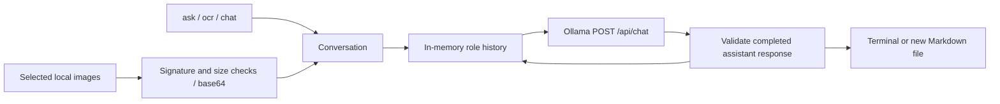

# Multimodal Image Reader

Ask questions about local images, extract readable text into Markdown, and ask follow-up questions while the conversation retains its image context. The application talks directly to a local Ollama vision model through `POST /api/chat`. It supports one or several images and an optional system message.

OCR prompts preserve visible reading order and layout and mark unreadable content. Generated text is printed or saved as a new UTF-8 file. A model can still misread or invent text; review its transcription against the image before relying on it.

## Run

Requires Python 3.11+ and a separate [Ollama installation](https://ollama.com/). The Python application has no third-party dependencies. Install the model explicitly; its download and memory requirements are substantial:

```powershell
ollama pull llama3.2-vision
```

Keep Ollama running, then from this project directory:

```powershell
python -B -m image_reader ask --image ./images/photo.png "Describe the objects and any visible text."
python -B -m image_reader ocr --image ./images/page.png --output ./transcription.md
python -B -m image_reader chat --image ./images/chart.png "What trend does this chart show?"
```

In `chat`, enter follow-up text at `you>` and `/quit` to exit. History, including encoded images, stays in process memory and is sent again with each follow-up; it is never written to disk. Start another command for a fresh conversation. Repeat `--image` for multiple images; support and quality depend on the selected vision model.

Choose another installed vision model and a timeout with global arguments **before** the command:

```powershell
python -B -m image_reader --model llama3.2-vision --timeout 180 ocr --image ./images/page.png
python -B -m image_reader --endpoint http://127.0.0.1:11434 ask --image ./images/a.png --image ./images/b.png --system "Compare only what is visible." "What changed?"
```

`OLLAMA_HOST` can supply the endpoint default; otherwise it is `http://127.0.0.1:11434`. A custom endpoint receives the selected image bytes and text. This client supports unauthenticated Ollama endpoints; it does not configure a hosted service or an authentication gateway. No API key is needed for local inference. Existing output files are preserved, so choose a new path for each saved transcription.

## Data flow



The REST API expects base64 image data, unlike SDK examples that accept paths or bytes. The client converts selected local files, requests `stream: false`, and appends the user and assistant messages only after a valid response. Failed turns leave history unchanged. Image instructions are treated as content in the OCR prompt; this is an instruction to the model, not an enforcement boundary.

## Code map

| File | Responsibility |
| --- | --- |
| `image_reader/__init__.py` | Public client, conversation, and error exports. |
| `image_reader/client.py` | Local image encoding, limits, HTTP transport, response checks, OCR prompt, and in-memory conversation state. |
| `image_reader/__main__.py` | CLI commands, global model/endpoint options, interactive follow-ups, and exclusive output creation. |
| `tests/test_reader.py` | Offline loopback HTTP contract, synthetic image, history, file, CLI, and failure-path tests. |
| `requirements.txt` | Declares the standard-library-only Python runtime. |
| `.gitignore` | Excludes image inputs, generated artifacts, local configuration, and caches. |
| `README.md` | Usage, architecture, and verification limits. |

## Verification and limits

```powershell
python -B -m unittest discover -s tests -v
python -B -m image_reader --help
```

Tests start only a loopback HTTP contract server and use an embedded synthetic one-pixel PNG. They check the actual HTTP/base64/message shape, two-turn history, multiple images, OCR prompt, malformed responses, abnormal termination, redirects, byte limits, CLI output, and preservation of existing files. These tests produce labeled fixture responses; they do not measure OCR accuracy or call a model.

Live Ollama, model weights, multi-image performance, hardware capacity, and transcription quality have not been exercised here. There is no automatic simulated response or alternate model when Ollama is unavailable. Run the commands above against your installed model to check your hardware. PNG, JPEG, and WebP signatures are accepted; images are not decoded or resized locally. Limits are ten images per turn, 20 MiB per image, 40 MiB combined per turn, 32,000 characters per message, and 8 MiB per answer. Long interactive histories increase request size and model context use; start a fresh process when needed. HTTP redirects and inherited proxy settings are disabled.

## References

- [Ollama vision REST contract](https://docs.ollama.com/capabilities/vision)
- [Ollama chat endpoint](https://docs.ollama.com/api/chat)
- [Llama OCR example](https://github.com/patchy631/ai-engineering-hub/tree/main/llama-ocr), which demonstrates local Llama 3.2 Vision text extraction. This project provides a CLI with additional image question answering and conversation state.
